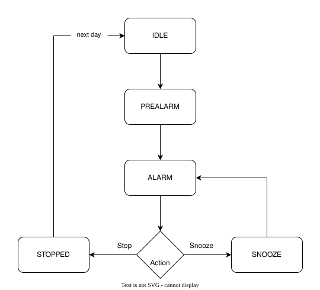

# ioBroker.alarmclock

[](https://www.npmjs.com/package/iobroker.alarmclock)
[](https://www.npmjs.com/package/iobroker.alarmclock)


[](https://nodei.co/npm/iobroker.alarmclock/)

**Tests:** 

## alarmclock adapter for ioBroker

An adapter for setting up an alarm clock.

## Installation

Please use the "adapter list" in ioBroker to install a stable version of this adapter. You can also use the CLI to install this adapter:

```bash
iobroker add alarmclock
```

## Documentation

The order of precedence for alarm times (the last one applied takes priority):

1. Time of day
2. Vacation
3. Public holidays
4. Appointments

The Alarm clock workflow:



### Adapter configuration

Configuring the adapter

#### Public holiday calendar

Here you can select the instance of the "feiertage" (public holidays) adapter.
This is then used to check for the holiday alarm.

#### Vacation calendar

Here, you can select the iCal adapter instance.
This is used to check for calendar events that trigger the vacation alarm.

The list determines which events should be acted upon.
e.g., vacation, time off, sick leave, etc.

#### Wake-up time calendar

Here, you can select the iCal adapter instance.
This is used to check for calendar events that define the wake-up time.

The start time of the event is set as the wake-up time.

The list determines which events should be acted upon.

e.g., alarm, wake-up call, etc.

#### MQTT-Broker

Here you can select the instance and the name of the topic for the mqtt adapter.
This is then used to publish and subscribe the mqtt values.

#### Action settings

Here you can add actions that are executed when the alarm clock's status changes.

#### Light alarm clock

Here you can add actions to be executed by the light alarm clock.

#### Miscellaneous

Here, you can set the duration of the wake-up delay history.

### Objects

#### Actions

| Name   | Function    |
| ------ | ----------- |
| snooze | Pause alarm |
| stop   | Stop alarm  |

#### Configuration

| Name            | Function                   | Default    |
| --------------- | -------------------------- | ---------- |
| enabled         | Alarm enabled              | false      |
| preAlarmMinutes | Pre-alarm time in minutes  | 20 minutes |
| skipNext        | Skip next alarm            | false      |
| snoozeMinutes   | Snooze duration in minutes | 10 minutes |

#### Runtime Values

`countdownPreAlarm`, `countdownAlarm`, `countdownSnooze`, `sunriseBrightness`, and `sunriseProgress` are updated every 30 seconds.

| Name                  | Function                                                        | Example                  |
| --------------------- | --------------------------------------------------------------- | ------------------------ |
| active                | Alarm is active                                                 | false                    |
| countdownAlarm        | Time remaining until alarm                                      | 512 minutes              |
| countdownAlarmText    | Time remaining until alarm formatted as HH:mm                   | 13:47                    |
| countdownPreAlarm     | Time remaining until pre-alarm                                  | 492 minutes              |
| countdownPreAlarmText | Time remaining until pre-alarm formatted as HH:mm               | 25:59                    |
| countdownSnooze       | Countdown until the end of the snooze period                    | 8 minutes                |
| countdownSnoozeText   | Countdown until the end of the snooze period formatted as HH:mm | 08:22                    |
| nextAlarm             | Next alarm                                                      | 2026-11-18T07:00:00.000Z |
| nextPreAlarm          | Next pre-alarm                                                  | 2026-11-18T06:40:00.000Z |
| snoozeUntil           | Snooze until                                                    | 2026-11-16T18:37:15.554Z |
| state                 | State                                                           | ARMED                    |
| sunriseBrightness     | Sunrise alarm brightness                                        | 21%                      |
| sunriseProgress       | Sunrise alarm progress                                          | 20.598%                  |

The state of the alarm clock can take on the following values:

- **DISABLED**: The alarm clock is disabled
- **ARMED**: The alarm clock is waiting
- **PREALARM**: The alarm clock is in the pre-alarm phase
- **TRIGGERED**: The alarm clock has been triggered
- **SNOOZE**: The alarm clock is in snooze mode
- **STOPPED**: The alarm clock has been stopped
- **ERROR**: Error

#### Wake-up times

All times are in HH:mm format

| Name      | Function                     | Default |
| --------- | ---------------------------- | ------- |
| monday    | Wake-up time on monday       | 06:00   |
| tuesday   | Wake-up time on tuesday      | 06:00   |
| wednesday | Wake-up time on wednesday    | 06:00   |
| thursday  | Wake-up time on thursday     | 06:00   |
| friday    | Wake-up time on friday       | 06:00   |
| saturday  | Wake-up time on saturday     | 08:00   |
| sunday    | Wake-up time on sunday       | 08:30   |
| vacation  | Wake-up time during vacation | 10:30   |
| holiday   | Wake-up time on holidays     | 09:30   |

#### Statistics

| Name             | Function                  |
| ---------------- | ------------------------- |
| alarmCount       | Number of alarms          |
| preAlarmCount    | Number of pre-alarms      |
| snoozeCount      | Number of times snoozed   |
| stopCount        | Number of times stopped   |
| errorCount       | Number of errors          |
| lastWakeDelay    | Last wake-up delay        |
| averageWakeDelay | Average wake-up delay     |
| bestWakeDelay    | Best wake-up delay        |
| worstWakeDelay   | Worst wake-up delay       |
| wakeDelayHistory | History of wake-up delays |
| lastAlarm        | Last alarm                |
| lastWakeup       | Last wake-up time         |

### MQTT

The alarm clock's MQTT interface.

[An example template for FHEM is available here.](./docs/fhem.cfg).

#### MQTT publish

Publishing alarm clock data to the MQTT-Broker.

| Topic                                       | Function                                 |
| ------------------------------------------- | ---------------------------------------- |
| &lt;TOPIC&gt;/config/enabled                | Alarm enabled                            |
| &lt;TOPIC&gt;/config/preAlarmMinutes        | Pre-alarm time in minutes                |
| &lt;TOPIC&gt;/config/skipNext               | Skip next alarm                          |
| &lt;TOPIC&gt;/config/snoozeMinutes          | Snooze duration in minutes               |
| &lt;TOPIC&gt;/runtime/countdownAlarm        | Time remaining until                     |
| &lt;TOPIC&gt;/runtime/countdownAlarmText    | Formatted time remaining until alarm     |
| &lt;TOPIC&gt;/runtime/countdownPreAlarm     | Time remaining until pre-alarm           |
| &lt;TOPIC&gt;/runtime/countdownPreAlarmText | Formatted Time remaining until pre-alarm |
| &lt;TOPIC&gt;/runtime/nextAlarm             | Next alarm                               |
| &lt;TOPIC&gt;/runtime/nextPreAlarm          | Next pre-alarm                           |
| &lt;TOPIC&gt;/runtime/state                 | State                                    |
| &lt;TOPIC&gt;/runtime/sunriseBrightness     | Sunrise alarm brightness                 |
| &lt;TOPIC&gt;/schedule/monday               | Wake-up time on monday                   |
| &lt;TOPIC&gt;/schedule/tuesday              | Wake-up time on tuesday                  |
| &lt;TOPIC&gt;/schedule/wednesday            | Wake-up time on wednesday                |
| &lt;TOPIC&gt;/schedule/thursday             | Wake-up time on thursday                 |
| &lt;TOPIC&gt;/schedule/friday               | Wake-up time on friday                   |
| &lt;TOPIC&gt;/schedule/saturday             | Wake-up time on saturday                 |
| &lt;TOPIC&gt;/schedule/sunday               | Wake-up time on sunday                   |
| &lt;TOPIC&gt;/schedule/holiday              | Wake-up time on holidays                 |
| &lt;TOPIC&gt;/schedule/vacation             | Wake-up time during vacation             |

#### MQTT subscribe

Controlling the alarm clock via the MQTT-Broker.

| Topic                                | Function                     | Values      |
| ------------------------------------ | ---------------------------- | ----------- |
| &lt;TOPIC&gt;/action/enabled         | Enable alarm                 | true, false |
| &lt;TOPIC&gt;/action/snooze          | Enable snooze                | true        |
| &lt;TOPIC&gt;/action/stop            | Stop alarm                   | true        |
| &lt;TOPIC&gt;/action/preAlarmMinutes | Pre-alarm time               | 25          |
| &lt;TOPIC&gt;/action/skipNext        | Skip next alarm              | true, false |
| &lt;TOPIC&gt;/action/snoozeMinutes   | Snooze duration              | 11          |
| &lt;TOPIC&gt;/action/monday          | Wake-up time on monday       | 07:00       |
| &lt;TOPIC&gt;/action/tuesday         | Wake-up time on tuesday      | 07:05       |
| &lt;TOPIC&gt;/action/wednesday       | Wake-up time on wednesday    | 07:10       |
| &lt;TOPIC&gt;/action/thursday        | Wake-up time on thursday     | 07:15       |
| &lt;TOPIC&gt;/action/friday          | Wake-up time on friday       | 07:20       |
| &lt;TOPIC&gt;/action/saturday        | Wake-up time on saturday     | 08:30       |
| &lt;TOPIC&gt;/action/sunday          | Wake-up time on sunday       | 09:30       |
| &lt;TOPIC&gt;/action/holiday         | Wake-up time on holidays     | 10:30       |
| &lt;TOPIC&gt;/action/vacation        | Wake-up time during vacation | 10:00       |

## Changelog

<!--
    Placeholder for the next version (at the beginning of the line):
    ### **WORK IN PROGRESS**
-->

### **WORK IN PROGRESS**

- (Volker Ganswind) Added support for Actions for Alarmclock-States
- (Volker Ganswind) Added support for Actions for light alarm clock

### 0.0.5 (2026-11-24)

- (Volker Ganswind) Added support for public-holidays-Adapter
- (Volker Ganswind) Added support for MQTT-Client-Adapter
- (Volker Ganswind) Minor bug fixes

### 0.0.4 (2026-11-19)

- (Volker Ganswind) Sentry deaktiviert

### 0.0.3 (2026-11-19)

- (Volker Ganswind) Formatted remaining time added

### 0.0.2 (2026-11-18)

- (Volker Ganswind) Second version

### 0.0.1 (2026-11-17)

- (Volker Ganswind) initial release

## License

MIT License

Copyright (c) 2026 Volker Ganswind <volker@ganswind.de>

Permission is hereby granted, free of charge, to any person obtaining a copy
of this software and associated documentation files (the "Software"), to deal
in the Software without restriction, including without limitation the rights
to use, copy, modify, merge, publish, distribute, sublicense, and/or sell
copies of the Software, and to permit persons to whom the Software is
furnished to do so, subject to the following conditions:

The above copyright notice and this permission notice shall be included in all
copies or substantial portions of the Software.

THE SOFTWARE IS PROVIDED "AS IS", WITHOUT WARRANTY OF ANY KIND, EXPRESS OR
IMPLIED, INCLUDING BUT NOT LIMITED TO THE WARRANTIES OF MERCHANTABILITY,
FITNESS FOR A PARTICULAR PURPOSE AND NONINFRINGEMENT. IN NO EVENT SHALL THE
AUTHORS OR COPYRIGHT HOLDERS BE LIABLE FOR ANY CLAIM, DAMAGES OR OTHER
LIABILITY, WHETHER IN AN ACTION OF CONTRACT, TORT OR OTHERWISE, ARISING FROM,
OUT OF OR IN CONNECTION WITH THE SOFTWARE OR THE USE OR OTHER DEALINGS IN THE
SOFTWARE.
